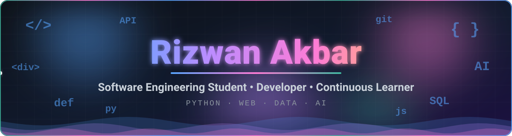
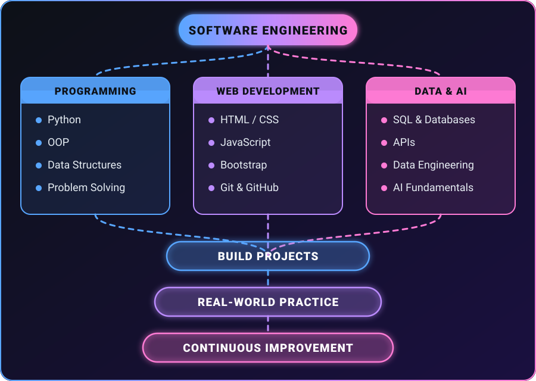

<picture>
  <source media="(prefers-color-scheme: dark)" srcset="assets/dark.svg" />
  <source media="(prefers-color-scheme: light)" srcset="assets/light.svg" />
  
</picture>

  
  
  

## 👋 About Me

I'm a **BS Software Engineering student** who enjoys learning how software works and turning what I learn into practical projects.

My current journey is centered around **Python, web development, programming fundamentals, and software engineering**. Alongside this, I'm exploring **backend development, databases, data engineering, and AI** to understand where these areas fit into modern software systems.

> 💡 *I believe progress comes from consistent practice: writing code, building projects, making mistakes, fixing them, and learning from the process.*

## 🧭 What I'm Focused On

<table>
<tr>
<td width="50%" valign="top">

### 💻 Programming

**Python**

- Programming fundamentals
- Functions & modules
- OOP
- Data structures
- Problem solving
- Daily coding practice

</td>

<td width="50%" valign="top">

### 🌐 Web Development

**Frontend → Backend**

- HTML5
- CSS3
- JavaScript
- Bootstrap
- Responsive design
- APIs & backend concepts

</td>
</tr>

<tr>
<td width="50%" valign="top">

### 🗄️ Data

**Exploring Data Engineering**

- SQL
- Databases
- APIs
- Data processing
- Data pipelines
- Cloud concepts

</td>

<td width="50%" valign="top">

### 🤖 AI

**Exploring AI-powered Software**

- AI fundamentals
- AI APIs
- Intelligent applications
- Machine learning concepts
- AI + software engineering

</td>
</tr>
</table>

## 🛠️ Technologies

  

## 🚀 Projects

<table>
<tr>
<td align="center" width="50%">

📅 **A daily journey of learning and practicing web development.**

</td>
<td align="center" width="50%">

🐍 **Daily exercises and small projects for improving Python fundamentals and problem-solving.**

</td>
</tr>
<tr>
<td align="center" width="50%">

💼 **A portfolio website built while learning HTML, CSS, and Bootstrap.**

</td>
<td align="center" width="50%">

🛒 **A JavaScript project focused on logic, user input, validation, and cart functionality.**

</td>
</tr>
</table>

## 📈 GitHub Activity

  

  

## 🗺️ My Learning Path

## 🤝 Let's Connect

I'm always happy to connect with other learners, developers, and recruiters.

 

